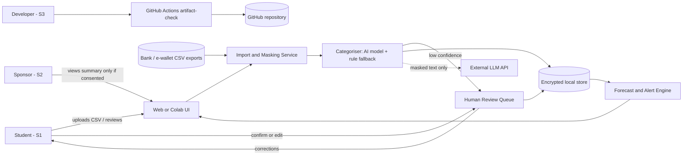

# 05 Lightweight System Architecture

## Diagram

## Components
| Component | Responsibility |
|-----------|----------------|
| Web/Colab UI | Upload, dashboard, review screen, consent toggle |
| Import and Masking Service | Parses CSV, removes account numbers and personal names |
| Categoriser | AI classification with a confidence score; keyword rules as fallback |
| Human Review Queue | Holds items below 70% confidence until the student decides |
| Encrypted local store | Transactions, corrections, budget limits |
| Forecast and Alert Engine | Projects month-end balance, raises warnings |
| External LLM API | Optional; receives masked merchant text only |
| GitHub Actions | Runs the artifact validator on every push |

## Data flows
1. CSV export -> masking -> categoriser -> store.
2. Low-confidence items -> human review -> corrections stored and reused.
3. Store -> forecast -> dashboard/alerts.
4. Masked text -> external LLM (optional, only if fallback rules do not match).

## Human oversight points
- Student confirms every low-confidence category.
- Student sets budget limits and can dismiss alerts.
- Sponsor sharing is opt-in.
- Developer reviews CI results before releasing changes.

## Design rationale
- **Rule-based fallback** keeps the system working if the AI fails and gives a baseline to compare against (QAS-02).
- **Masking before any external call** limits privacy harm (QAS-03).
- **Human review queue** keeps the student accountable for decisions (QAS-01).
- **Local storage** avoids a cloud database, so there is less attack surface and a simpler design for a small problem.
